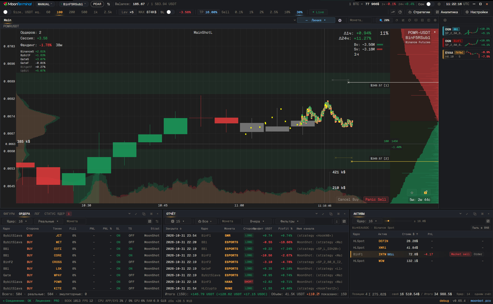
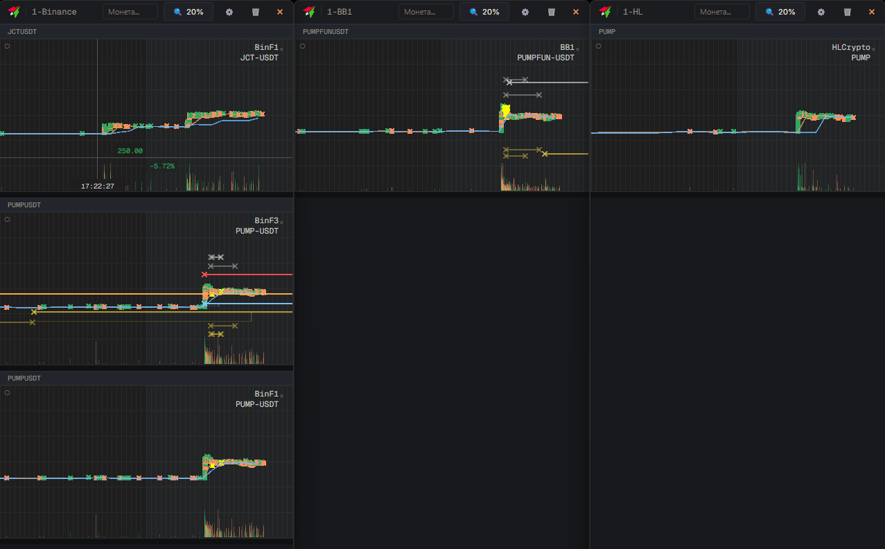
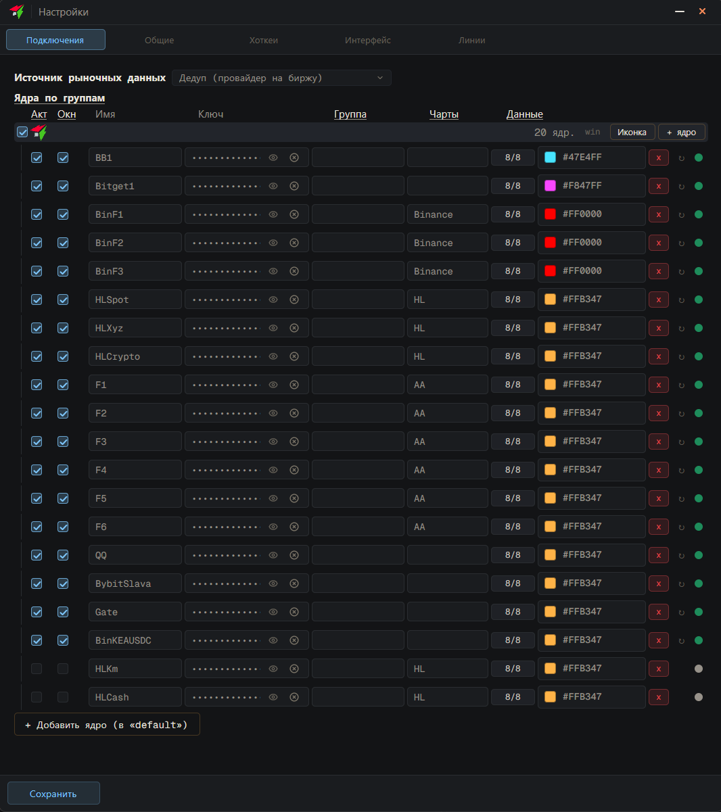

<p align="center">
  <a href="https://moonbot.pro">
    
  </a>
</p>

<h1 align="center">MoonTerminal</h1>

<p align="center">
  <b>Кроссплатформенный десктопный торговый терминал для ядра Moonbot</b><br>
  GPU-рендеринг графиков · живой поток MoonProto · Windows · macOS · Linux
</p>

<p align="center">
  <a href="https://github.com/Moonbot-Tech/MoonTerminal/actions/workflows/build.yml"></a>
  <a href="https://github.com/Moonbot-Tech/MoonTerminal/releases"></a>
  
  
  
  
</p>

<p align="center">
  <b>Русский</b> · <a href="README.md">English</a>
  &nbsp;&nbsp;|&nbsp;&nbsp;
  <a href="#возможности">Возможности</a> ·
  <a href="#скриншоты">Скриншоты</a> ·
  <a href="#архитектура">Архитектура</a> ·
  <a href="#сборка">Сборка</a> ·
  <a href="#конфигурация">Конфигурация</a> ·
  <a href="#откуда-берутся-обновления">Обновления</a> ·
  <a href="#документация">Документация</a>
</p>

<p align="center">
  <a href="https://moonterminal.pro/ru/"><b>moonterminal.pro</b></a> — скачивание, инструкция и FAQ на восьми языках ·
  <a href="https://moonbot-tech.github.io/MoonTerminal/">Тур по интерфейсу</a>
</p>

MoonTerminal — десктопная оболочка для Windows, macOS и Linux, через которую трейдер управляет ядрами **[Moonbot](https://moonbot.pro)**: графики, ордера, отчёты и стратегии в одном окне. Сам терминал не торгует: он подключается к ядру Moonbot по ключу. Исходный код открыт на GitHub. Не связан с сайтом moonterminal.io и со сторонними торговыми Telegram-ботами под похожими именами.

> **В разработке.** Это рабочее пространство активной разработки терминала: оболочка на GPUI, интеграция MoonUI, живой поток данных MoonProto, платформенный GPU-рендеринг графиков и отладочный инструментарий. Это ещё не готовый упакованный продукт.

<p align="center">
  
</p>

## Возможности

- **GPU-рендеринг графиков** — собственный GPU-проход на каждой платформе (DirectX 11 под Windows, Metal под macOS, нативный `wgpu` под Linux). Без CPU-readback, поэтому live-скролл и зум остаются плавными и не перерисовывают всё окно.
- **Живой поток MoonProto** — событийные рыночные данные через backend-цикл на waker'е. Видимый график подтягивает данные на кадровом тике, а не постоянным поллингом.
- **Торговые панели** — ордера и редактирование ордеров, стакан, отчёты, активы и кошельки, рыночный скринер и дерево стратегий для ваших ядер Moonbot.
- **Ордерные линии на графике** — строятся из текущего снапшота плюс захваченных событий, поэтому короткие терминальные статусы (`Cancel` / `Fail` / `Done`) не теряются.
- **Открепляемые окна** — вкладки графиков и панели дока выносятся в отдельные окна; состояние дока и раскладки сохраняется между сессиями.
- **Локализация интерфейса** — русский, английский, испанский, украинский, турецкий, бразильский португальский, вьетнамский и упрощённый китайский через `rust-i18n`.
- **Шифрованная конфигурация** — учётные данные серверов хранятся в защищённом хранилище / кейринге ОС (Secret Service под Linux).
- **Мелочи для повседневной работы** — звуки алертов, иконки монет, свои хоткеи и темы, а также встроенный `chart-smoke` FireTest, который проверяет живые bounds графика, нативный ввод и счётчики CPU/GPU/RAM.

## Скриншоты

<table>
  <tr>
    <td width="50%"></td>
    <td width="50%"></td>
  </tr>
  <tr>
    <td align="center"><sub>Графики — GPU-рендеринг свечей, стакан, ордерные линии</sub></td>
    <td align="center"><sub>Настройки → Подключения — настройка по каждому ядру</sub></td>
  </tr>
</table>

## Архитектура

MoonTerminal — виртуальный workspace на Rust: UI-независимое ядро, поверх которого работает оболочка на GPUI.

| Крейт | Ответственность |
|---|---|
| [`moon-core`](crates/moon-core) | UI-независимое ядро — подключения, конфиг, сессии, market state, отчёты. |
| [`moon-chart`](crates/moon-chart) | Математика графика — time/price view, дефолтный масштаб, pan/zoom, оси (без wgpu). |
| [`moon-tg`](crates/moon-tg) | Telegram-бот и Mini App — общие для десктопного терминала и станции. |
| [`moon-ui-gpui`](crates/moon-ui-gpui) | Бинарь `moonterminal` — GPUI shell, панели, debug-инструменты, интеграция графика. |
| [`moon-station`](crates/moon-station) | Серверный бинарь без окна — реплика отчётов, трассы ордеров и лента сделок. |
| [`moon-remote`](crates/moon-remote) | Готовит Linux-сервер для `moon-station` по SSH, с машины терминала. |
| [`Moonbot-Tech/MoonUI`](https://github.com/Moonbot-Tech/MoonUI) | Внешняя Git-зависимость — standalone GPUI runtime + компоненты Moon UI. |

**Рендер.** График рисуется отдельным GPU-проходом поверх MoonUI/GPUI — DX11/HLSL под Windows, Metal под macOS, нативный `wgpu`/WGSL-бэкенд GPUI под Linux. График сам решает, нужен ли кадр, и готовит данные к этому же кадру, поэтому оболочка и панели ордеров не перерисовываются на частоте live-скролла или движения мыши.

**Data path.** События MoonProto приходят через event sink с waker'ом; backend-цикл будится реальными событиями и командами, а не таймером. Видимый график тянет рыночные данные на кадровом тике, а core-owned общий read-model обслуживает остальных потребителей.

Полная картина — в [документе об архитектуре](docs/ARCHITECTURE.md).

## Сборка

### Клонирование

```bash
git clone https://github.com/Moonbot-Tech/MoonTerminal.git
cd MoonTerminal
```

### Windows

Требования:

- Git
- Rust через `rustup`
- Visual Studio 2022 Build Tools с C++-тулчейном и Windows SDK
- Опционально: `make`

```powershell
cargo build -p moon-ui-gpui --bin moonterminal --target x86_64-pc-windows-msvc
```

Отладочный исполняемый файл:

```text
target\x86_64-pc-windows-msvc\debug\moonterminal.exe
```

### macOS

Требования:

- Xcode или рабочий Metal-тулчейн
- Rust через `rustup`

```bash
cargo build -p moon-ui-gpui --bin moonterminal
```

Каноничная проверка Metal — см. [гайд по сборке под macOS и Linux](docs/MAC_LINUX_BUILD.md).

### Linux

В релизах новее `v0.66.0` есть терминал для Linux x86_64: один исполняемый файл
`MoonTerminal-linux-x86_64`. В
[гайде по сборке под macOS и Linux](docs/MAC_LINUX_BUILD.md#linux) — пакеты, которые нужны ему
для запуска, пакеты для сборки под Ubuntu/Debian, которые CI ставит в чистый контейнер, и
настройка Secret Service, которая нужна шифрованному конфигу в пользовательской GUI/DBus-сессии.
Чтобы собрать самому, когда пакеты для сборки установлены:

```bash
cargo build -p moon-ui-gpui --bin moonterminal
```

### Основные команды

| Команда | Назначение |
|---|---|
| `make run` | собрать и запустить отладочный терминал |
| `make build` | отладочная сборка |
| `make release` | релизная сборка |
| `make check` | проверка типов |
| `make fmt` | `cargo fmt` |
| `make clean` | очистить `target` |
| `make update-moon-ui` | сдвинуть пин MoonUI в коммитимом `Cargo.lock` |
| `make update-moonproto` | сдвинуть пин MoonProto (отдельным осознанным коммитом) |
| `make update-all` | сдвинуть ВСЁ, включая сторонние пины — снимает заморозку версий |

Makefile выбирает MSVC-таргет на Windows и нативный таргет на macOS/Linux.

## Конфигурация

Серверы настраиваются в интерфейсе приложения:

```text
Настройки → Подключения
```

Настройка подключений по каждому ядру — см. [скриншот «Настройки → Подключения»](#скриншоты) выше.

Рантайм-конфиг лежит рядом с исполняемым файлом. Учётные данные серверов хранятся в шифрованном конфиге через защищённое хранилище/кейринг ОС, где доступно. Локальные конфиг-файлы и логи игнорируются Git.

## Откуда берутся обновления

Каждый релиз собирает и публикует [GitHub Actions](https://github.com/Moonbot-Tech/MoonTerminal/actions/workflows/release.yml) в этом репозитории, из открытого исходного кода. Вручную бинарники никто не загружает.

- Релиз собирается только из тега версии, который стоит на `main`, а в `main` изменения попадают только через pull request. На странице каждого релиза указан коммит, из которого он собран, и лог сборки открыт.
- Публикация ждёт одобрения мейнтейнера в защищённом окружении `release`. Перед тем как релиз станет публичным, сборка сверяет SHA-256, которые GitHub посчитал для загруженных файлов Windows, Linux и станции, с файлами, которые она сама собрала.
- Релизы неизменяемые: после публикации ни тег, ни его файлы заменить нельзя.
- Встроенный обновлятор ставит только эти релизы. Черновики, пре-релизы и любой изменяемый релиз он пропускает, качает только с `github.com/Moonbot-Tech/MoonTerminal/releases/download/<тег>/` и до замены файла сверяет его размер и SHA-256 с тем, что опубликовал GitHub. При расхождении установленная версия остаётся как была. Без нажатия **«Обновить до …»** ничего не ставится.

Windows SmartScreen предупреждает о `MoonTerminal.exe`, потому что файл пока не подписан сертификатом. Проверить скачанный файл самому можно так: сравнить его хеш со значением `sha256:` рядом с файлом на [странице релиза](https://github.com/Moonbot-Tech/MoonTerminal/releases):

```powershell
Get-FileHash .\MoonTerminal.exe -Algorithm SHA256
```

## Документация

| Документ | Что внутри |
|---|---|
| [Инструкция для пользователей](https://moonterminal.pro/ru/) | Сайт: скачивание, справочник по интерфейсу, FAQ и история версий на восьми языках |
| [Тур по интерфейсу](https://moonbot-tech.github.io/MoonTerminal/) | Интерактивный тур: карта главного окна, первое подключение, панели, хоткеи |
| [Архитектура](docs/ARCHITECTURE.md) | Крейты, платформенный GPU-рендеринг и живой data path |
| [Отчёты в Telegram](docs/TELEGRAM_REPORTS.md) | Привязка бота, клавиатура и виды отчётов, уведомления (на английском) |
| [FireTest](docs/FIRETEST.md) | Встроенный live-зонд `chart-smoke` |
| [Сборка под macOS и Linux](docs/MAC_LINUX_BUILD.md) | Проверка Metal и настройка Linux |
| [Окна](docs/WINDOWING.md) | Своя шапка окна и borderless/CSD-поведение |

---

<p align="center">
  Moonbot · Продвинутый терминал для торговли криптовалютой · <a href="https://moonbot.pro">moonbot.pro</a>
</p>
